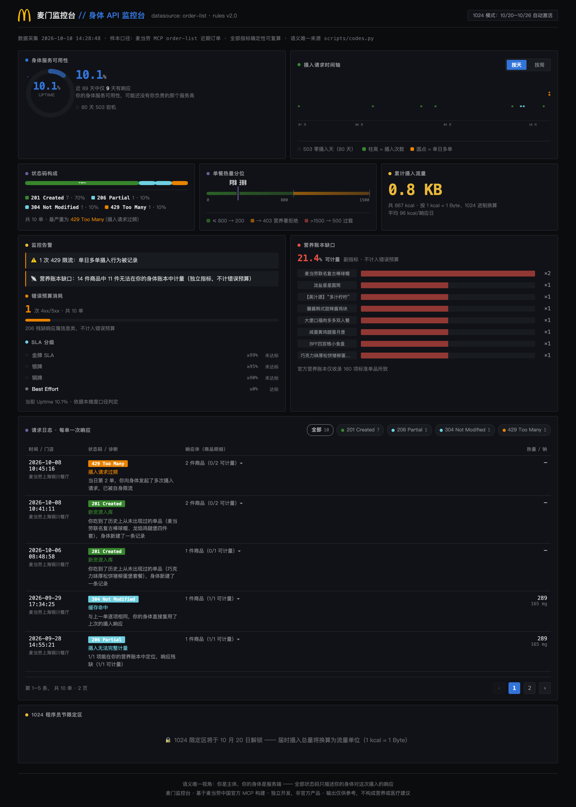
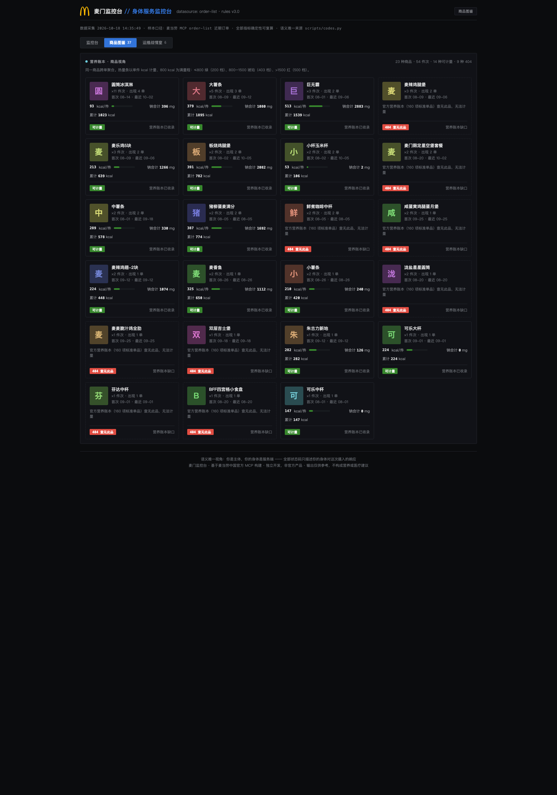
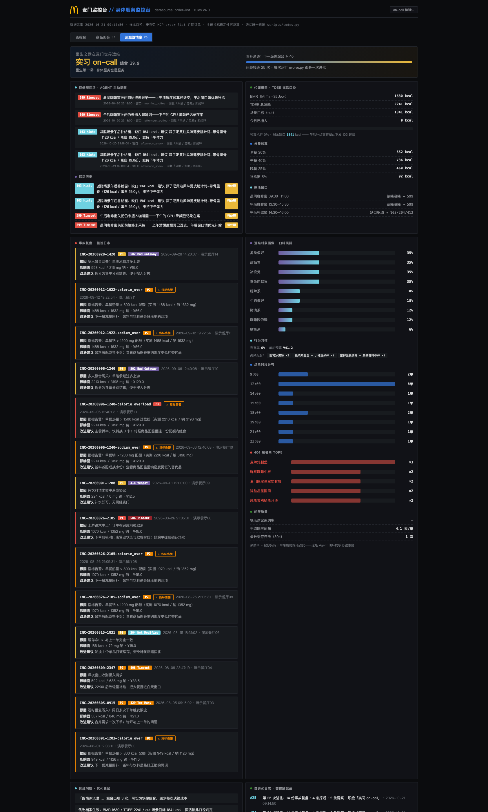
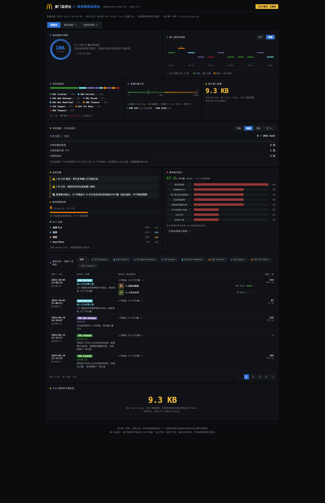
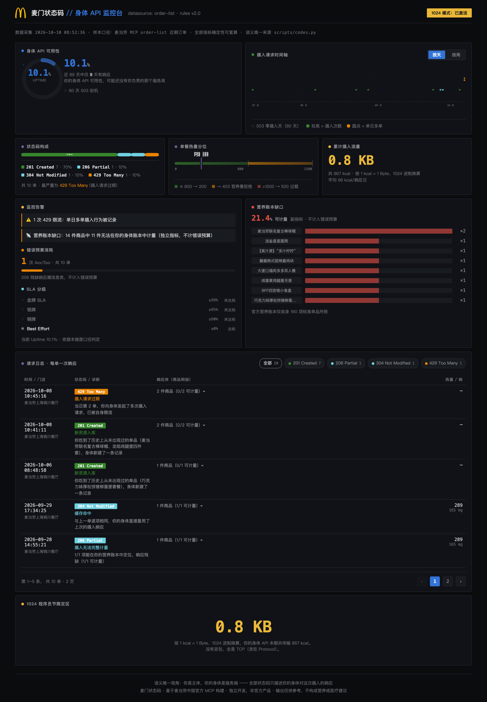

# 麦门监控台


*（Logo 取自大赛官方仓库 [M-China/mcd-developer-innovation-challenge](https://github.com/M-China/mcd-developer-innovation-challenge) 活动横幅，版权归麦当劳所有）*

> **打开一份属于你的麦当劳数据大盘。**
> 用程序员熟悉的语言（Uptime / 错误预算 / 状态码分布 / SLA 分级）呈现你的用餐记录，
> 一眼看清吃了几次、吃得多重、哪里断了供。
> 1024 程序员节 × 麦当劳官方 MCP 参赛作品。

<p align="center">
  <a href="https://chaucerj.github.io/mcd-status-codes/"><b>🎮 在线试玩间（免Token、零安装，官方菜单+时间轴探活）→</b></a>
</p>

<p align="center">
  <a href="#star"></a>
  <a href="#star"></a>
  <a href="https://github.com/M-China/mcd-developer-innovation-challenge/issues/264"></a>
</p>

| 项目信息 | 内容 |
|---|---|
| **赛事** | 麦当劳中国程序员节创意开发大赛（[活动仓库](https://github.com/M-China/mcd-developer-innovation-challenge)） |
| **形态** | Agent Skill + 本地 Python 确定性分类器 + 单文件 HTML 监控面板 |
| **数据来源** | 麦当劳中国官方 MCP（`https://mcp.mcd.cn`），只读采集 |
| **运行环境** | Python 3.10+，纯标准库，零第三方依赖 |
| **在线试玩** | [chaucerj.github.io/mcd-status-codes](https://chaucerj.github.io/mcd-status-codes/) —— 免 Token、零安装；官方菜单 107 项带图，时间轴驱动 Agent 探活 |
| **仓库导航** | 见 [HOMEPAGE.md](HOMEPAGE.md) |



## 两级页面

顶部导航在两个层级间切换（支持 URL 深链：`#gallery` 直达图鉴页）：

- **监控台**（一级）：Uptime 仪表、摄入时间轴、状态码构成、热量分位、监控告警、SLA 分级、请求日志。日志展开后每件商品带官方缩略图与单件热量迷你条，最新一单默认展开。
- **商品图鉴**（二级，`#gallery`）：同一商品跨单聚合的图形化营养账本——官方商品图、单件 kcal 热量条（≤800 绿 / 800–1500 琥珀 / >1500 红，配额与指标告警三档）、钠合计、出现轨迹。营养账本查无此品的商品以虚线卡与首字磁贴呈现 404。
- **运维战情室**（三级，`#ops`）：**重生之我在麦门世界运维**——你是自己身体服务的 on-call 工程师。事故复盘（每笔 4xx/5xx 订单生成 INC 编号 / P1-P3 定级 / 根因 / 改进建议的 postmortem）、**待处理探活队列**（Agent 主动提醒的落地面）、代谢模型卡（BMR/TDEE/分餐预算/探活窗口）、运维对象口味画像、SRE 职级晋升通道（实习 on-call → 麦门世界 CTO）。

**v3.0 双方向状态码宪法**：ingest 摄入方向 14 码（你的身体对每次摄入的响应）+ probe 探活方向 6 码（103 Early Hints 补给建议下发 / 204 主动静默 / 412 被目标否决 / 425 过早打扰 / 599 建议窗口超时 / 522 连续窗口失联）。Agent 按 Mifflin-St Jeor 代谢模型（体重/身高/年龄 → BMR → TDEE → 场景目标 → 分餐预算）在三个补给窗口主动探活：晨间/午后咖啡窗监测咖啡因摄入（打工人醒脑），午后补给窗按 TDEE 缺口决定是否建议下午茶（减脂人群），窗口关闭未采纳即 599 超时、连续失联升级 522。形态上致敬 @f-cfan 饭点雷达的「它来找你」——但信号源不同：它盯券池，我们盯你的代谢缺口。





**场景定位选择**：监控台「定位视图」面板支持均衡 / 减脂 / 增肌 / 打工人四种定位一键切换（localStorage 本机记忆），每种定位有专属指标卡与针对性策略；定位同时驱动探活窗口行为——减脂/增肌启用午后补给窗（103 补给 / 412 拦截 / 204 静默），打工人侧重晨间与午后咖啡窗（599 超时判定）。对 Agent 说「切换到 XX 定位」即可同步探活档案。

## Agent 自进化循环

每次运行 `python3 scripts/evolve.py` 就是一次「交接班」：事故复盘、口味画像、职级、洞察全部由**确定性规则**重新计算（数值不进 LLM、逐条可复算），学习结果沉淀进 `data/prefs.json`——越用越懂你。Agent（WorkBuddy / Claude 等）负责编排循环、播报变化、把你口述的偏好（忌口 / 目标 / 预算）写进档案。

*（按天维度：89 天里 9 天有响应，Uptime 10.1%）*

<details>
<summary><b>▸ 点击展开：周维度 / 1024 限定模式</b></summary>



*（切到按周维度：14 周里 6 周有响应，Uptime 42.9% —— 同一份数据的另一种观察粒度）*



*（10/20–10/26 活动窗口自动解锁：把摄入总量按 1 kcal = 1 Byte、1024 进制换算为流量单位）*

</details>

---

## 语义宪法：你是主体，你的身体是服务端

这是本项目唯一且不可妥协的视角约定。

> 每一笔订单 = 一次摄入请求，打向你的身体；
> **状态码 = 你的身体对这批摄入的响应。**

推论（三条铁律）：

1. 每个状态码的定义句，主语只能是**你 / 你的身体 / 你的摄入行为**
2. 麦当劳官方数据、MCP 接口、营养表等平台侧事实，**只能作为诊断证据**，绝不充当状态码定义
3. 一个状态码**只有一个含义**，且全项目逐字一致

**为什么这条如此重要**：早期版本的 404 一会儿指"官方营养表查不到这件商品"（平台视角），
一会儿指"身体账本记不下"（自身视角），语义漂移导致读者无法判断指标到底在说什么。
现在语义的**唯一事实源是 [`scripts/codes.py`](scripts/codes.py)**，
分类器、面板与全部文档都从它读取——语义漂移在工程上被根除了。

## 为什么做这个

麦当劳 App 里能看到订单列表，但看不到**趋势**：这个月比上月吃得多还是少？断供了几天？
连点两次的那天到底发生了什么？这些问题的答案需要一个监控面板，而不是一个流水账。

我们把它做成程序员一眼就能读懂的形态——因为状态码、Uptime、错误预算是我们每天在盯的东西。

真实账户上跑出的三组数据：

- **Uptime 10.1%**：89 天里只有 9 天有订单记录。你的用餐可用性，可能还没有你负责的那个服务高。
- **429 限流真实存在**：某天连点两单，第二单被判定为请求过频。
- **404 → 200 可复现**：从零订单起步，下一单即被记录，大盘当场跳变。

## 安装

零第三方依赖，Python 3.10+ 即可。

```bash
git clone https://github.com/chaucerj/mcd-status-codes.git
cd mcd-status-codes
```

### 作为 Agent Skill 导入

本仓库即 Skill 目录（`SKILL.md` 在根目录，符合 Agent Skill 规范）。克隆后在 WorkBuddy / Claude / Cursor 等客户端中将仓库目录作为 Skill 加载，Agent 会按 `SKILL.md` 的值班手册工作：会话开始先播报待处理探活，再按需采集/分类/进化/出面板。`references/` 下有两份速查：`state-codes.md`（20 码语义全表，由 codes.py 单一事实源生成）与 `agent-playbook.md`（Agent 播报手册：开场模板、偏好代笔脚本、探活闭环话术）。

配置 MCP Token（在 [open.mcd.cn/mcp](https://open.mcd.cn/mcp) 登录 → 控制台 → 激活获取）：

```bash
export MCD_MCP_TOKEN=你的Token
```

## 使用

```bash
# 1. 采集（只读：历史订单 + 营养表 + 积分账户）
python3 scripts/collect.py

# 2. 分类（确定性规则引擎，可复算）
python3 scripts/classify.py

# 3. 生成监控面板（单文件 HTML，双击打开）
python3 scripts/report.py

# 1024 程序员节限定模式（10/20–10/26 自动激活，也可手动开启）
python3 scripts/report.py --1024
```

没有 Token？用合成演示数据体验完整流程：

```bash
python3 scripts/make_demo.py
python3 scripts/classify.py demo/demo_orders.json
python3 scripts/report.py
```

## 状态码定义表

> 本表与 [`scripts/codes.py`](scripts/codes.py) 逐字一致，由它生成。判定阶梯从最"贵"的失败到常规成功，首个命中即停。

| 状态码 | 你的身体发生了什么 | 确定性触发条件 |
|---|---|---|
| **504 Gateway Timeout** | 上游中止—— 这次摄入最终没有发生，链路在上游超时中止 | 订单状态为已取消 |
| **429 Too Many Requests** | 摄入请求过频—— 你在同一天发起了多次摄入，身体对你限流 | 当日第 2 单及以后 |
| **408 Request Timeout** | 请求超时—— 你在深夜发起摄入请求，但身体已不在服务时段 | 下单时间落在 22:00–04:59 |
| **418 I'm a teapot** | 我是茶壶—— 你只点了饮料，请求打到了茶壶而不是餐桌 | 整单商品均为饮品 |
| **502 Bad Gateway** | 聚合网关—— 这一次请求聚合了多个子请求，单次摄入量过大 | 单笔商品总件数 ≥ 6 |
| **304 Not Modified** | 缓存命中—— 这次摄入与上一单完全一致，身体直接复用了上次的响应 | 商品组合与份数同上一单逐项相同 |
| **301 Moved Permanently** | 取餐渠道永久改道—— 你的取餐路径换了节点，并已永久指向新渠道 | 本次取餐方式与上一单不同 |
| **201 Created** | 新资源入库—— 你吃到了历史上从未出现过的单品，身体新建了一条记录 | 该品名在此前全部订单中均未出现过 |
| **206 Partial Content** | 摄入无法完整计量—— 你的身体账本里查不全这次摄入，返回的是残缺甚至空的响应 | 部分（0/N 至 N-1/N）商品无法在营养账本中定位 |
| **200 OK** | 摄入已入账—— 你的身体正常受理了这次摄入，并完成记账 | 全部商品热量可计算 |

**指标告警层（v4.0）**：营养负荷（热量/钠）是 metrics 不是状态码——超配额记入 breaches 触发事故复盘，不改变订单的状态码。

| 告警 | 阈值 | 级别 |
|---|---|---|
| 热量超配额 | 单餐 > 800 kcal | P2 |
| 热量过载 | 单餐 > 1500 kcal | P1 |
| 钠超标 | 单餐 > 1200 mg | P2 |

### 集合层状态码

不产生于单笔订单，只作用于整个订单集合：

| 状态码 | 含义 | 触发 |
|---|---|---|
| **404 Not Found** | **订单不存在**—— 你的身体服务上还没有任何订单资源 | 初始拉取时订单集合为空 |
| **503 Service Unavailable** | **身体服务宕机**—— 这一天你的身体服务完全没有响应 | 当日零订单，计入 Uptime 分母 |

## 两个关键设计决定

### 1. 404 只保留一个触发条件，且能变成 200

404 **不再**有"商品查不到营养表"这层含义。它只表示一件事：
**你的身体服务上还没有任何订单资源**——这是最标准的一种 REST 404。

对零订单用户，首次运行会直接渲染一张 404 彩蛋页：
资源不存在，而**这个「不存在」本身就是结论**。接着执行下单脚本，
资源被创建，集合层状态码立刻从 404 跳到 200：

```bash
python3 scripts/order.py                        # 试算：列出收藏门店与巨无霸价格
python3 scripts/order.py --store 3350181 --item 巨无霸三件套 --confirm   # 真正下单
```

这条"404 → 200"的路径是**可复现的**：任何人拿自己的账号都能走一遍。

### 2. 「营养账本缺口」从状态码降级为独立指标

官方营养表只收录 160 项标准单品，联名款/套餐无法按品名匹配。
若把它塞进 404 会造成语义污染（404 说的是"资源不存在"，不是"账本记不全"）。

所以它现在是面板上的**独立指标「营养账本覆盖率」**，与状态码体系正交。
它衡量的是"你的身体账本能记全多少"，而不是接口行为。

## 监控面板输出

Grafana 暗色科技风，单文件 HTML 零依赖。图表全部为**手绘 SVG**，不引任何图表库；
运行时零JavaScript 依赖，纯静态文件双击即开。

**三组交互，状态彼此独立、互不干扰**：

| 交互 | 位置 | 说明 |
|---|---|---|
| 统计维度 | 时间轴右上 | 按天 / 按周，切换后 Uptime 分母、状态码构成、错误预算全部按新维度重算 |
| 状态码筛选 | 日志标题右侧 | chips 形式，点击只看某一类响应码；自动回到第 1 页 |
| 日志分页 | 日志右下 | 每页 5 单，页码超7 页自动折叠为省略号；焦点在日志区内可用 ← → 翻页 |

维度切换示例：按天 10.1%（9/89 天有响应）→ 按周 42.9%（6/14 周有响应）。
同一份数据的两种观察粒度，稀疏程度不同，适合看趋势 vs 看细节。

| # | 组件 | 说明 |
|---|---|---|
| 1 | **Uptime 环形仪表** | 20 格刻度环+ 渐变弧，弧长即结论 |
| 2 | **摄入请求时间轴** | 按当前维度分桶，柱高=摄入次数，色=当期最严重状态码，圆点标记单日多单 |
| 3 | **状态码构成** | 横向堆叠条，色块内嵌百分比，窄段自动省略改由 tooltip 承载 |
| 4 | **单餐热量标尺** | 分段渐变量程 + 阈值刻度线，P50/P99 指针落位 |
| 5 | **累计摄入流量** | 1 kcal = 1 Byte，1024 进制换算 |
| 6 | **监控告警 + 错误预算 + SLA 分级** | 金/银/铜/ Best Effort 四档，按当前维度判定 |
| 7 | **营养账本缺口清单** | 无法计量的商品 Top 8（副指标） |
| 8 | **请求日志** | 分页 + 状态码筛选，含诊断文案与可展开的商品明细 |
| 9 | **1024 限定区** | 摄入总量换算为流量单位 |

无障碍：分段按钮与筛选 chips 均带 `role` / `aria-checked` / `aria-pressed`，
所有图表带 `role="img"` 与 `aria-label`，颜色不作为唯一信息载体，
交互元素均有 `:focus-visible` 焦点环。

## 目标用户

- **程序员/互联网从业者**：看得懂状态码，也想看看自己的用餐数据大盘长什么样。面板天然适合发群、发朋友圈
- **想复盘饮食习惯的人**：比"年度账单"多一层持续监控视角——趋势、断供、复发都有指标可看
- **麦当劳会员**：想知道"我吃的这些到底多少热量"——顺带发现官方营养表的覆盖缺口

## 隐私与边界

- 所有数据留在本机 `data/` 目录（已 gitignore），Token 只从环境变量读取
- 采集全程只读；唯一的写操作是 `order.py`，且**默认只试算**，需显式 `--confirm` 才会下单
- 不领券、不抽奖、不改账户；下单前必然先跑 `calculate-price` 并展示金额
- 输出为娱乐性数据复盘，不构成营养或医疗建议；餐品信息以麦当劳官方渠道实时结果为准

## 参赛说明

本作品为麦当劳程序员节创意开发大赛参赛项目，基于麦当劳中国官方 MCP（`https://mcp.mcd.cn`）开发，独立开发、非官方产品。MCP 接入说明见 [MCP_INTEGRATION.md](MCP_INTEGRATION.md)。

---

<h2 id="star" align="center">喜欢这份大盘的话，帮我点一下 ⭐</h2>

<p align="center">
  <a href="https://github.com/chaucerj/mcd-status-codes/stargazers"></a>
  <a href="https://github.com/chaucerj/mcd-status-codes/network/members"></a>
  <a href="https://github.com/chaucerj/mcd-status-codes/watchers"></a>
</p>

这是我在麦当劳程序员节创意开发大赛的参赛作品，**正在按 Star 数排名中**。

如果你也想看自己的麦当劳账户长什么样——

- **点 ⭐ Star**：这是对我最直接的认可，也是让作品被更多人看到的唯一方式
- **点 🍴 Fork**：拿去改成你自己的版本，用你自己的订单数据跑一遍
- **点 👀 Watch**：后续迭代（更多状态码、更多维度）我会在这里通知

**不用注册任何东西、不需要 Token、点一下就好。** 三秒钟。

<p align="center">
  <a href="https://github.com/chaucerj/mcd-status-codes"><b>⭐ Star 这个仓库</b></a>
  &nbsp;·&nbsp;
  <a href="https://github.com/chaucerj/mcd-status-codes/issues/264"><b>查看参赛 Issue</b></a>
  &nbsp;·&nbsp;
  <a href="https://github.com/M-China/mcd-developer-innovation-challenge"><b>查看官方活动仓库</b></a>
</p>